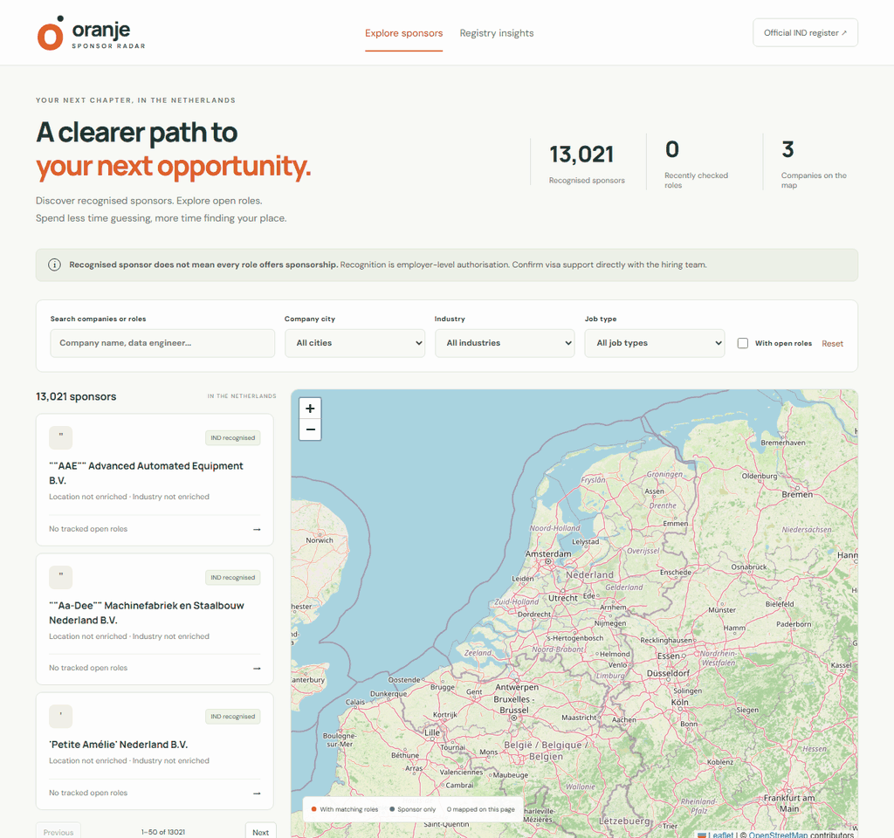

<p align="center">
  
</p>

# Oranje Sponsor Radar

A map-based career discovery MVP for international professionals and graduates
in the Netherlands. Search employers on the official IND work sponsor register
and explore Netherlands vacancies from explicitly mapped public ATS boards.

**IND recognition is employer-level authorisation, not a promise of sponsorship
for every vacancy.** This application does not verify a vacancy's visa support.
All collected jobs are labelled "not stated / not verified". Confirm eligibility
and visa support directly with the employer before applying.

## Portal preview



Recorded from the live local deployment: 13,021 recognised sponsors and three
enriched company locations. The GIF demonstrates company search and city filters;
no tracked vacancies are available in this sample. Map data
[&copy; OpenStreetMap contributors](https://www.openstreetmap.org/copyright).
The original logo is also available as an [editable SVG](assets/logo.svg).

## Stack

| Layer | Technology | Purpose |
| --- | --- | --- |
| Frontend | React 19, TypeScript, Vite, React Leaflet | Map, search, filters, company/job details, registry insights |
| API | Python 3.12, FastAPI, SQLAlchemy | Read-only discovery API and freshness metadata |
| Python tooling | uv workspace, dependency groups, uv.lock | Locked environments for development, Docker and CI |
| Database | PostgreSQL 17 in Docker | Sponsors, vacancies, lifecycle events, daily observations, run audit |
| Ingestion | Python, httpx, Beautiful Soup | Official IND HTML register; Greenhouse and Lever public APIs |
| Analytics | dbt Core, dbt-postgres | Raw landing, staging, intermediate logic and dimensional marts |
| Scheduling | Dedicated Compose service | Startup refresh, then daily at a configured UTC hour |

DuckDB is intentionally not a second production store. It can be added later
for local analysis of PostgreSQL exports without changing the serving database.

## Start locally

Prerequisite: Docker Desktop with its **Linux container engine running**.
No local Node or Python installation is needed for Compose.

### Live registry

From the repository root in PowerShell:

```powershell
Copy-Item .env.example .env
# Edit .env: choose a unique POSTGRES_PASSWORD. Keep DEMO_MODE=false.
docker compose up --build -d
docker compose run --rm api python -m radar.cli refresh
docker compose --profile tools run --rm analytics
```

Open <http://localhost:8080>. API documentation is at
<http://localhost:8000/docs>.

The initial live refresh imports the actual IND work register.
**The live configuration includes three sample location mappings:** ASML Holding,
ASML Netherlands and Adyen. IND does not supply industries, coordinates, career
pages, or ATS mappings. The sample locations were corroborated using GLEIF and
PDOK; see [enrichment sources and sync](ENRICHMENT-README.md). Other sponsors stay
unmapped until enriched, and jobs stay empty until verified ATS boards are added.
No demo vacancies or guessed company matches are silently substituted.

To enable daily refreshes and dbt builds:

```powershell
docker compose --profile live up -d scheduler
docker compose logs --tail 100 scheduler
```

The scheduler runs once immediately, then at `REFRESH_HOUR_UTC` (default `4`).
It must remain running on a host that stays online. Each failed or partial
refresh logs an error, is recorded in the database, and exits unsuccessfully
when run via the CLI. The scheduler skips dbt after such a refresh and tries
again at the next scheduled time. dbt failures are reported in scheduler logs.

### Try the portal with fictional data

Use a **different Compose project and database volume**. Create `.env.demo` from
the example and set `DEMO_MODE=true`, a unique password, and `POSTGRES_DB=radar_demo`.
Stop the live project first if its localhost ports are in use:

```powershell
docker compose stop
docker compose --env-file .env.demo -p oranje-demo up --build -d
docker compose --env-file .env.demo -p oranje-demo run --rm api python -m radar.cli seed-demo
```

The demo has five fictional sponsors and vacancies. The UI shows a demo banner,
and fictional vacancies cannot be opened as real applications. Seeding requires
an empty demo database; it is not meant to be run repeatedly. Do not start the
live scheduler in demo mode. Database mode is persisted and checked on startup:
changing the environment flag cannot relabel demo records as verified live data.

### Add verified company coverage

For free-source options and the bounded GLEIF/PDOK/Wikidata enrichment sync,
see [Company enrichment sources and sync](ENRICHMENT-README.md).

Edit [config/companies.json](config/companies.json), following
[config/companies.example.json](config/companies.example.json). The example is
illustrative, not a verified employer, and must not be copied unchanged.

For each employer:

1. Find its exact eight-digit KVK in the IND work register. Keep leading zeros.
2. Verify the legal entity's relationship to its official careers site and
   Greenhouse or Lever board. A similar company name is not sufficient.
3. Supply a company city and Netherlands coordinates; industry is optional. These are
   curated enrichment, not IND-verified attributes or job-site coordinates.
4. Optionally add a verified careers URL, ATS provider, board slug, and explicit Netherlands location terms.
   A company can be mapped without job collection by omitting provider/board.
5. Run a refresh. Unknown KVKs, duplicate mappings and invalid configurations
   fail explicitly.

Only one legal-entity mapping per ATS board is allowed to avoid attributing the
same jobs to multiple subsidiaries. Only vacancies matching configured location
terms are retained. Generic "Remote" and foreign locations are excluded; a
multi-country location containing a configured term can still require manual
review. Do not use ambiguous terms such as "Remote" or "Europe".

The default filters are company city, industry, job type, company/job title,
and whether matching fresh jobs exist. City means the curated **company
location**, not a guarantee about where a vacancy is based. The map shows the
current result page (50 companies); unmapped sponsors remain searchable.
Company details show up to 20 matching jobs and link to the careers page.

## Data lifecycle and safety

- The [IND work register](https://ind.nl/en/public-register-recognised-sponsors/public-register-work)
  is published monthly. Daily observation does not make the source real-time.
- Sponsors are keyed by KVK, not company name. Duplicate KVK rows are grouped
  into aliases for one legal entity. Entries with no published KVK use a
  deterministic name-based ID; renaming these appears as removal/addition.
- The first import establishes a **baseline**, not thousands of "new sponsors".
  Subsequent observations produce `added`, `removed`, and `restored` events.
  Company cards flag additions observed within the last 30 days; baseline
  entries never receive that flag.
- A removal means **no longer observed on the register**. It is not proof of
  revocation or the legal date on which recognition ended.
- Every successful registry observation upserts one UTC daily snapshot.
  Same-day retries preserve daily event counts, including repeated transitions.
  Missing days are not backfilled or represented as successful observations.
- Snapshots record aggregate counts, observation timestamp, source URL and SHA-256
  response hash. Original IND/ATS HTTP response bodies are also archived in `raw`
  before parsing, including error responses and malformed payloads.
- A valid registry must have the expected table, valid identifiers and at least
  1,000 legal entities. Removal of **more than 10%** of existing active sponsors
  aborts the transaction. Review legitimate mass changes before deliberately
  adjusting this guard in code; there is no automatic bypass.
- PostgreSQL advisory locking prevents overlapping complete refreshes.
  SQLite is used only for local smoke/unit tests, not concurrent deployment.
- A failed ATS request never closes previous jobs. Only a successfully parsed
  complete board response can close missing vacancies. Boards commit independently;
  failures produce a `partial` run and preserve successful updates.
- The portal hides jobs not checked within **72 hours**, and all jobs belonging
  to sponsors no longer listed. Historical job snapshot counts mean stored
  active jobs at observation time; they can include retained jobs from a failed
  board, and are not a count of confirmed visa-sponsored vacancies.
- Recognition older than two days and unsuccessful refreshes are surfaced in
  the UI. The pipeline run audit records timestamps, status and source errors.

## Analytics

[analytics/](analytics/) follows four explicit layers:

| Layer | PostgreSQL schema | Ownership and responsibility |
| --- | --- | --- |
| **Raw** | `raw` | Python loads source data without warehouse cleansing; dbt declares sources, not transformed raw models |
| **Staging** | `analytics_staging` | `stg_*` views rename fields, trim whitespace, standardize casing and cast dates, timestamps, booleans and numerics |
| **Intermediate** | `analytics_intermediate` | `itm_*` views deduplicate repeated extracts, join business entities, calculate job eligibility and aggregate metrics |
| **Marts** | `analytics_marts` | Materialized `dim_*` and `fct_*` tables with documented grains and tested relationships |

dbt's default schema naming is retained: `DBT_SCHEMA` (default `analytics`) is
prefixed to each transformed layer. For example, `DBT_SCHEMA=alice` creates
`alice_staging`, `alice_intermediate` and `alice_marts`, avoiding developer
collisions. The shared ingestion schema remains `raw`.

### What "raw" contains

There are two explicitly distinguished source types:

- `raw.source_responses` archives the original IND HTML and ATS JSON **response
  bytes** after HTTP transport decompression, before parsing or location
  filtering. It includes status, URL, content type, observation time, run ID and
  SHA-256. Non-2xx and invalid bodies are retained; transport failures with no
  response are recorded only in the pipeline audit. Whitespace, duplicate source
  rows, foreign job locations and unknown JSON fields are not discarded.
- `raw.extract_batches` and `raw.entity_records` land **unchanged operational
  database extracts** after refreshes. Each JSON payload preserves its source
  row's values (dates/timestamps use lossless ISO serialization). These are
  application-source records, not unprocessed IND/ATS payloads. The portal's
  existing processing still governs its operational `public` tables.

The dbt transformation path consumes the operational extracts, not HTTP HTML
parsing or guessed JSON structures. Raw responses are independent audit/replay
evidence; an invalid response is never promoted into accepted warehouse rows.
There is no automatic HTTP-response replay command yet.

Landing writes are append-only: repeated refreshes create new batches without
updating prior payloads. All four entity extracts commit together. A partial
ATS refresh captures the resulting state, preserving the previous failed-board
jobs; a failed registry refresh creates no entity batch. Demo batches are
explicitly marked and never mixed with live data.

This MVP takes full extracts on each refresh. Plan retention, incremental
extraction and restricted ingestion-role permissions before scaling; application
code never overwrites raw records, but database roles do not enforce immutability
yet.

### Transformations and dimensional model

Staging performs no joins to business entities, deduplication or aggregation.
KVK is always **text**, so leading zeros survive. Invalid casts fail the build
rather than silently becoming defaults.

Intermediate models select the latest extracted version of each source key,
using extraction time and raw row ID for deterministic ordering. Other
intermediate models apply the recognised-employer/active-job/72-hour freshness
rule and aggregate tracked, active and discoverable roles per sponsor. One
build-wide reference time keeps freshness calculations consistent across marts.

| Mart | Grain and semantics |
| --- | --- |
| `dim_sponsor` | One current row per sponsor, including removed entities; Type 1, not SCD2 |
| `dim_date` | One UTC calendar date, with an integer `YYYYMMDD` key |
| `fct_job_openings` | One current row per tracked vacancy, including closed/stale roles; eligibility is as of the build |
| `fct_sponsor_events` | One baseline/add/remove/restore observation event, linked to sponsor and date dimensions |
| `fct_daily_sponsor_metrics` | One actual observed day, with counts and net sponsor change; no fabricated missing days |
| `fct_sponsor_job_metrics` | One current aggregated row per sponsor, including sponsors with zero tracked jobs |

The warehouse does not claim vacancy-level sponsorship verification or legal
effective dates. Names in the current sponsor dimension can change; lifecycle
facts retain observed events, not full historical dimension attributes.

Tests cover raw keys, staging types/categorical values, deduplicated keys,
fact/dimension relationships, nonnegative counts, daily change reconciliation
and sponsor/job aggregate reconciliation. The CI integration check also verifies
layer boundaries and that repeated raw extracts produce only one mart row per key.

### Running dbt

```powershell
docker compose --profile tools run --rm analytics
```

For a local dbt CLI, install the uv `analytics` group, export the
`POSTGRES_HOST`, `POSTGRES_PORT`, `POSTGRES_USER`, `POSTGRES_PASSWORD` and
`POSTGRES_DB` environment variables, and run:

```powershell
$env:DBT_SEND_ANONYMOUS_USAGE_STATS = "false"
uv sync --locked --group analytics
uv run --no-sync dbt build --project-dir analytics --profiles-dir analytics
uv run --no-sync dbt docs generate --project-dir analytics --profiles-dir analytics
```

To upgrade an existing MVP database, run `init` again to create the **additive**
raw schema/tables, then explicitly extract existing operational data:

```powershell
docker compose run --rm api python -m radar.cli init
docker compose run --rm api python -m radar.cli export-raw
docker compose --profile tools run --rm analytics
```

This does not manufacture historical raw HTTP responses. Replaced legacy
`analytics.sponsor_directory`, `analytics.sponsor_lifecycle` and
`analytics.daily_sponsor_metrics` views, if present, are not automatically
dropped; update consumers to the marts before removing those views manually.
Refresh and explicit export share the same PostgreSQL advisory lock.

## API

| Endpoint | Purpose |
| --- | --- |
| `GET /api/health` | Database connectivity |
| `GET /api/meta` | Coverage, freshness, mode, latest run errors and filter options |
| `GET /api/sponsors` | Paginated recognised sponsors and matching fresh jobs |
| `GET /api/history?days=30` | Daily counts and latest 100 non-baseline events in the period |

Sponsor query parameters: `q`, `city`, `industry`, `job_type`, `has_jobs`,
`limit` (1-100), and `offset`. Supported types: `full-time`, `part-time`,
`internship`, `contract`, `unknown`. Unknown job types are never inferred from
titles. Search input is literal text, including SQL wildcard characters.

## Development and validation

Install [uv](https://docs.astral.sh/uv/getting-started/installation/) and Node 22.
Run Python commands from the repository root; no manual virtualenv activation
or pip installation is needed:

```powershell
uv sync --locked --group analytics
uv run --no-sync pytest backend\tests -q
uv run --no-sync ruff check backend analytics\check_warehouse.py
uv run --no-sync ruff format --check backend analytics\check_warehouse.py

Set-Location frontend
npm ci
npm run build
npm test
```

The root [pyproject.toml](pyproject.toml) defines a uv workspace containing the
[backend package](backend/pyproject.toml). `.python-version` pins Python 3.12;
[uv.lock](uv.lock) records the complete resolution. The default `dev` group
contains pytest/Ruff; the opt-in `analytics` group contains dbt Core/Postgres.
Docker installs with `uv sync --locked --no-dev --group analytics --no-editable`.
CI also syncs the lock rather than re-resolving dependencies.

Manage dependencies with uv instead of editing generated lock entries:

```powershell
uv add --package oranje-sponsor-radar <runtime-package>
uv add --dev <development-package>
uv add --group analytics <analytics-package>
uv lock --upgrade-package <package>
```

Commit manifest changes together with the updated lockfile. `uv sync --locked`
fails when manifests and the lockfile disagree. Without dbt, use `uv sync --locked`
and `uv run --locked <command>`; include `--group analytics` for dbt commands,
or use `--no-sync` after the full explicit sync above.

For separate frontend development, run the API on port 8000 and `npm run dev`
in the frontend directory. Vite proxies `/api` to the local backend. API startup
requires initialized tables:

```powershell
# Export POSTGRES_* variables, or DATABASE_URL for SQLAlchemy.
uv run --no-sync python -m radar.cli init
uv run --no-sync python -m uvicorn radar.api:app --host 127.0.0.1 --port 8000
```

By default the backend tests run against isolated in-memory SQLite databases
with foreign keys enabled. Setting `TEST_DATABASE_URL` additionally runs
database tests against PostgreSQL, creating and dropping a unique test-owned
schema per case. Use a dedicated test database with schema-creation permission.
The [CI workflow](.github/workflows/ci.yml) exercises both engines and runs
`dbt build` against a seeded PostgreSQL service, plus the React tests/build.
CI generates a fresh random PostgreSQL password for each job, masks it in logs,
and removes its temporary database container afterward. No fixed CI database
password or repository secret setup is required.
The seeded warehouse integration extracts the same five sponsors twice and
checks that staging retains ten rows while sponsor dimensions contain five.
Transactional integration probes also verify that raw whitespace remains intact,
staging trims it, intermediate selects the latest version, and closed/stale jobs
or jobs at removed sponsors are not discoverable. Those probe changes are rolled
back; the seeded data is not altered.
Tests mock network responses; they do not depend on the live IND site or ATS.

Useful operational commands:

```powershell
docker compose ps
docker compose logs --tail 100 api scheduler
docker compose stop
```

## MVP boundaries

- Greenhouse and Lever only; no generic career-page crawler, Workday/LinkedIn
  scraping, automatic geocoding, exhaustive vacancy coverage, or verified
  vacancy-level sponsorship claims.
- Company mapping is curated. Industry/location coverage is incomplete until
  enriched; missing jobs do not mean an employer is not hiring.
- No authentication, application tracking or alerts. Raw responses are archived
  from this version onward; there is no historical backfill or automatic replay.
- `create_all` bootstraps a fresh schema; it is **not** a migration system.
  Add reviewed migrations before changing schemas with retained deployment data.
- Compose binds services to localhost. Before public hosting, add TLS,
  appropriate database users/permissions, backups, monitoring, rate limits and
  review upstream source terms. OpenStreetMap's public tiles are suitable for
  light interactive use; comply with its attribution/usage policy or use a
  dedicated tile provider at scale.

## License

See [LICENSE](LICENSE).
